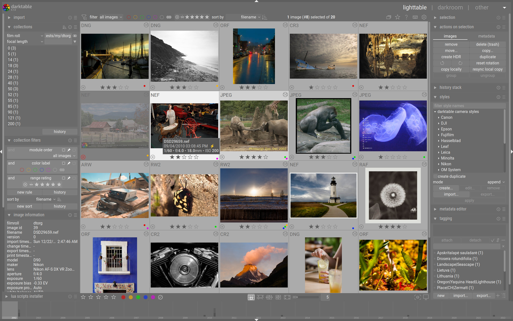
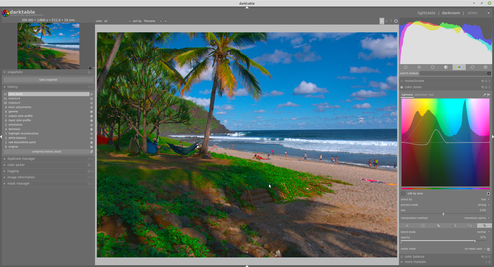

# darktable RAW Development From Selection To Delivery

A portrait session can produce hundreds of frames, several lighting conditions, and two very different deliverables: small proofs and full-resolution edits.
darktable photo editing connects those decisions through a searchable lighttable, a modular darkroom, and exports rendered from the original image plus its editing history.

## Reduce a shoot to its useful frames

Import the session, then decide which photographs deserve detailed work before copying a look across the collection.
The darktable photo editor keeps ratings, tags, and editing information alongside its image library.

1. Compare nearby frames for expression, focus, and motion.
2. Use star ratings for your shortlist and tags for subjects or locations.
3. Group related versions so alternative edits remain easy to find.
4. Keep exposure brackets identifiable instead of treating them as unrelated photographs.

The grouping behavior is described in [grouping.txt](doc/grouping.txt).
Metadata support also depends on Exiv2; [FindExiv2.cmake](cmake/modules/FindExiv2.cmake) locates that library during a source build.

For an already imported library, prepare the smaller thumbnail levels while the machine is idle:

```bash
darktable-generate-cache \
  --min-mip 0 \
  --max-mip 2
```

This processes the thumbnail cache, leaving the source photographs untouched.
The available resolution levels are documented in [darktable-generate-cache.pod](doc/man/darktable-generate-cache.pod).

[](https://darktable-photo-editing.github.io/darktable-photo-editor/)

## Build the edit around one representative frame

Choose a photograph with the lighting and subject tones that recur through the session.
Complete its basic corrections before applying shared settings to other frames.

### Establish light and color

- Check the crop and perspective before judging the composition.
- Set exposure with attention to the subject, rather than making every histogram look alike.
- Review white balance and color calibration together.
- Use a tone mapper suited to the intended result, then refine color with appropriate modules.
- Inspect noise reduction and sharpening at a useful zoom level.

The relationship between white balance and color calibration is explained in [README.md](dev-doc/iop/wb_and_colorcalibration/README.md).
Lens profile availability is a separate concern; [FindLensFun.cmake](cmake/modules/FindLensFun.cmake) identifies the Lensfun dependency.

Module selection and processing order answer different questions.
[Module_Groups.md](dev-doc/Module_Groups.md) explains how tools are organized, while [pixelpipe_architecture.md](dev-doc/pixelpipe_architecture.md) describes the rendering pipeline.
Keep the default processing order unless you understand why a particular operation needs to move.

### Limit corrections to the subject

A bright window should not force the same exposure change onto a face.
Use drawn masks to describe an area, parametric masks to select tonal or color ranges, and the mask preview to inspect the transition.



Refine edges at the intended viewing size, then toggle the module to check whether the local change still looks plausible.
The supplied [masks_data_model.md](dev-doc/masks_data_model.md) documents mask storage in the development tree.

### Keep repeated controls close

Place frequently used controls in the quick access panel rather than searching the full module list for every frame.
[Quick_Access_Panel.md](dev-doc/Quick_Access_Panel.md) describes that panel, and [Shortcuts.md](dev-doc/Shortcuts.md) explains the action system behind keyboard mappings.
For readers examining control behavior, [sliders.md](dev-doc/sliders.md) distinguishes displayed slider values from their internal values.

Copy only the settings that make sense across the selection.
A shared color treatment may transfer well; a subject-specific mask or exposure correction often needs individual review.

## Render a proof and a detailed handoff

Use the darktable raw photo editor to make separate outputs from the same edit instead of resizing the original photograph.
Choose the output profile, dimensions, and format for the recipient.

| Output decision | JPEG proof | 16-bit PNG handoff | What remains editable |
| --- | --- | --- | --- |
| Intended use | Review in a browser or messaging app | Further work in a compatible image editor | The darktable history remains with the source |
| Dimensions | Limit the long edge for convenient sharing | Retain the required image dimensions | Export size does not resize the RAW |
| Precision | Compact, lossy output | Lossless output with greater tonal precision | Neither output replaces the RAW data |
| Color | Usually sRGB for general viewing | Agree on a suitable output profile | Profile choices belong to the rendered output |

The following Bash examples assume darktable is installed, the input and sidecar exist, and the output directory already exists.
The first command makes a bounded JPEG; the second supplies a PNG bit-depth setting through darktable's core configuration interface.

```bash
darktable-cli "session/portrait.CR3" "session/portrait.CR3.xmp" \
  "proofs/portrait.jpg" --width 2048 --height 2048

darktable-cli "session/portrait.CR3" "session/portrait.CR3.xmp" \
  "handoff/portrait.png" \
  --core --conf plugins/imageio/format/png/bpp=16
```

[darktable-cli.pod](doc/man/darktable-cli.pod) documents the positional sidecar argument, dimension limits, and the format-specific configuration workaround.
The width and height values are maximum bounds, so a portrait photograph retains its aspect ratio.

A sidecar from the matching image supplies its processing history; a filename extension selects the export format.
Review profile and quality settings in your own configuration before using the same command for a whole session.
The main application's configuration and library options are listed in [darktable.pod](doc/man/darktable.pod).

## Resolve differences between previews and exports

An untouched RAW can initially show the camera's embedded JPEG in the lighttable.
That preview contains the camera manufacturer's processing, which can differ from darktable's interpretation.

After editing, compare a fresh export with the darkroom result under consistent viewing conditions.
The thumbnail pipeline, interactive preview, and full export have different performance requirements.



- Check whether the external viewer honors the embedded color profile.
- Confirm that darktable is using the intended monitor profile.
- Judge fine detail at comparable magnification.
- Use [high quality processing](https://docs.darktable.org/usermanual/5.6/en/darkroom/pixelpipe/the-pixelpipe-and-module-order/) for a final darkroom comparison when needed.
- If an operation is unusually slow, check OpenCL availability before assuming the edit is broken.

The supplied [thumbnail_color_management.txt](doc/thumbnail_color_management.txt) records thumbnail color-space handling.
[darktable-cmstest.pod](doc/man/darktable-cmstest.pod) describes the monitor-profile inspection utility, and [darktable-cltest.pod](doc/man/darktable-cltest.pod) covers the OpenCL check.
[FindLCMS2.cmake](cmake/modules/FindLCMS2.cmake) locates Little CMS, a color-management dependency.

For darktable linux users, package build options can affect available integrations.
Check the documentation for your installed version when comparing behavior across operating systems.

## Preserve the session as an editable collection

The darktable open source photo editor reconstructs an image from its source and history whenever it needs a new rendering.
[Core_Concepts.md](dev-doc/Core_Concepts.md) explains that model; [Module_Lifecycle.md](dev-doc/Module_Lifecycle.md) follows history replay and parameter changes.

Keep the following together in your archive:

1. Original RAW files and their directory structure.
2. Matching [XMP sidecars](https://docs.darktable.org/usermanual/5.6/en/overview/sidecar-files/sidecar/), including separate sidecars for duplicate editing versions.
3. Any additional edit-data sidecars created by your version.
4. A backup of the configuration directory and library databases.
5. Finished exports labeled by their intended use.

The development-tree [dtdata_sidecar.md](dev-doc/dtdata_sidecar.md) describes additional per-pixel edit data; its presence depends on the version and features used.
[Catalog_Access.md](dev-doc/Catalog_Access.md) explains the library's database responsibilities.
[README.md](dev-doc/README.md) provides the developer-documentation index for further investigation.

XMP history is useful for reconstructing edits, but it does not preserve every aspect of the library.
Before a major version change, retain a database backup as well as the image files and sidecars.

## Related Search Terms

darktable photo editing, darktable photo editor, darktable linux, darktable raw photo editor, darktable open source photo editor, darktable, photography, raw, photo-editing, image-processing, color-management, non-destructive, opencl, workflow, linux
